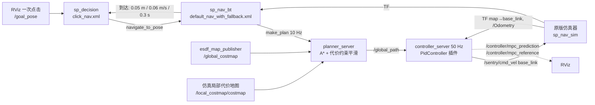

# RoboMaster 导航方向最终作业：一次点击迷宫导航

目标环境：**Ubuntu 22.04 x86_64 / ROS 2 Humble / Python 3.10**。
基于 TongjiSuperPower/sp_vision_tutorial_27 的 `final_project_nav` 分支，原始提交
`05c33fc8aa6695e76bcff310b42f8fdfe276e1cb`。

**验证状态：算法核心已编译测试，并接入原版动力学进行离线迷宫测试；整套 ROS 工程、RViz 插件和双层行为树尚未在 Ubuntu 22.04/Humble 上实机验证。请先完成下面的编译和整链路测试，再提交。** 当前开发环境为 Ubuntu 24.04；原版动力学离线测试使用 Python 3.10。不能将离线结果视为官方成绩。

## 1. 实现范围与合规边界

- `ControllerPlugin` 原始接口保持不变；实现 configure、setPlan、computeVelocityCommands，保留 `PidController` 的插件加载名（实际算法由参数 `controller_mode` 选择，默认 `mpc`，见第 4 节）。
- `/goal_pose` → 上层 `click_nav.xml` → `navigate_to_pose` Action → 下层 `default_nav_with_fallback.xml` → A* 服务 → `/global_path` → 控制器 → `/sentry/cmd_vel`。
- 补全地图路径、插件名、话题及坐标系；地图使用原版 `maze_map`。
- **整个 `sp_nav_sim`（含所有参数、动力学 `.so`）和地图逐字节保持原版**；保护文件摘要在 `docs/protected_files.sha256.json`。
- 正式运行不自动发目标，不改起点，不手动发速度，不通过仿真 GUI 拖拽机器人。
- 增加 RViz 精确目标输入工具：用户点击终点红标记一次，工具将附近点击吸附为精确 `(14.100,14.100)`，本次进程只发一次目标。该工具只发布目标，仍完整经过双层 BT。也保留原生 2D Goal Pose，若管理员限定原生工具，以管理员要求为准。

## 2. 第一次在 Ubuntu 虚拟机运行

将整个文件夹放在 Ubuntu 本机目录（例如 `~/rm_final_nav`），不要直接在 VMware 共享目录中编译。
此前 Lecture4 已安装的 Humble 可以继续使用。

```bash
cd ~/rm_final_nav
bash scripts/install_dependencies.sh
bash scripts/build.sh
bash bash/sim_nav_all_start.sh
```

安装脚本使用 apt 安装依赖，不更改 ROS 软件源。若 `ros-humble-*` 找不到，先检查之前配置的 Humble 软件源。编译默认串行，降低 exprtk 模板编译耗尽虚拟机内存的风险；仍需足够内存，首次构建可能较慢。

启动后应看到仿真窗口、行为树窗口和 RViz，终端应显示控制器插件加载成功。等待地图、蓝色机器人和红色目标标记出现，确认 RViz 的 Fixed Frame 为 `map`，机器人在左下角 `(0.9,0.9)` 附近。

1. RViz 点击工具栏 **Maze Goal (14.1,14.1)**（快捷键 `M`）。
2. 在迷宫右上角的红色目标标记处单击一次。只有距目标 0.3 m 内的点击会生效，发出的目标是精确坐标；窗口中其他点击不会发目标。
3. 不再点击目标，不拖动仿真机器人，不使用 Initial Pose，也不发布 `/sentry/cmd_vel`。
4. 等待导航成功和停车。终端会打印评测结果保存路径。
5. 用 Ctrl+C 关闭启动终端。下一轮测试重启整个启动脚本，使仿真恢复原始起点。

如未显示自定义工具：确认 `sp_nav_rviz_tools` 编译完成，并重新 source `install/setup.bash` 后启动 RViz。RViz 的 Add Tool 中也可选择该工具。

## 3. 验证方式

不依赖 ROS 的核心检查：

```bash
bash scripts/check_core.sh
python3 scripts/check_static.py
```

原版动力学离线测试（Ubuntu 22.04 的系统 Python 为 3.10；其它版本需另有 `python3.10`，用环境变量 `PLANT_PYTHON` 指定）：

```bash
python3 tests/offline_plant.py                 # 读取 nav_params.yaml 的全部参数
python3 tests/offline_plant.py 1.0 1.2         # 只改 max_speed 做对比
python3 tests/offline_plant.py --mode pursuit  # 备用控制模式
python3 tests/offline_plant.py --latency 0.025 --set dead_time=0.32   # 时延 / 模型失配
```

它编译生产代码实际使用的 C++ A* / 控制器核心，通过 ctypes 接入**原版** SimRobot、碰撞几何与 `_dyn_core.cpython-310-x86_64-linux-gnu.so`，参数直接读取 `nav_params.yaml`。控制器 50 Hz、仿真 30 Hz、规划 10 Hz；包含另外两台机器人的碰撞，重现局部地图采样/融合；到达判据与行为树相同。该测试不运行 ROS、DDS、TF 通信、BT、Qt 或 RViz，时间是模拟时间，不能证明完整集成通过。

完整 ROS 开发自检（先关闭正式仿真）：

```bash
source /opt/ros/humble/setup.bash
source install/setup.bash
python3 tests/ros_smoke.py
```

这个**开发测试**使用离屏显示，在节点就绪后仅发一次 `/goal_pose`，等待完整双层 BT 成功、稳定到达及停车。不会发布速度。正式验收仍需按上节在 RViz 中点击。失败查看 `test-output/ros-smoke/launch.log`。超时也算失败，不能只看机器人动了。

附有 `.github/workflows/ubuntu22.yml`，用于在 Ubuntu 22.04 / ROS Humble 容器中编译和整链路检查。**未在本次交付中执行该工作流，不代表 CI 已通过。**

## 4. 算法与参数

### 4.0 系统结构



控制插件内部：`路径 → 速度曲线 → 时延预测 → 线性 MPC（或 pursuit）→ 终点伺服 → 稳态表求逆 + 偏转补偿 → 旋到 base_link`。

### 4.1 先辨识被控对象

用仿真器自带的 `_dyn_core.Plant` 做阶跃实验（只调用、不修改），得到决定设计的几个事实：

| 现象 | 数值 | 设计上的对策 |
|---|---|---|
| `/sentry/cmd_vel` 按 `base_link` 解释，而 `base_link` 偏航 = 云台 yaw，默认以 1 rad/s 持续旋转 | 每秒转 57° | 用 TF yaw 把 map 速度旋到 base_link；按 TF 时间戳估计云台角速度，补偿“样本年龄 + 约 17 ms 等待下一仿真步”的滞后 |
| 指令到速度有纯时延 | ≈ 0.2 s（6 个 30 Hz 仿真步） | 1.4 m/s 时等于“盲开” 0.3 m，必须做状态预测 |
| 之后是限加速度的一阶滞后 | `v' = clip(3.4·(v_ss − v), ±2.0)` | 1.4 m/s 起的停车距离约 0.86 m，制动要按模型提前 |
| 底盘默认小陀螺 3 rad/s | 指令 > 1.1 m/s 后实际速度被压缩：指令 2 m/s → 实际约 1.44 m/s；速度方向逆时针偏约 5° | 指令幅值上限取仿真器 v_max = 2.0 m/s，巡航实际速度 1.42 m/s；用实测稳态表求逆；反向补偿方向偏转 |
| 机身是 0.5 m 正方形且在旋转 | 外接圆半径 0.354 m | 规划致命半径 0.25 + 0.18 = 0.43 m；平滑路径离墙 ≥ 约 0.52 m |

### 4.2 全局规划：A\* + 代价约束平滑（加分项：轨迹平滑）

- 八邻域 A\*，单格代价因子 `1 + cost_weight·cost/100`（偏向走廊中线），禁止对角穿过两个障碍格之间的角缝；保留精确起终点。
- 平滑（`sp_astar::smooth`）：按 0.1 m 重采样后做梯度平滑——每个内点向相邻点中点移动（曲率惩罚 `smooth_weight`），并被弱拉回原 A\* 路径（`smooth_data_weight`）。**一次移动只有在该点与两侧线段的最大代价都不超过 `smooth_max_cost = 40`（约离墙 0.52 m）时才接受**，所以平滑永远不会切进膨胀区。
- 第二阶段最小曲率细化（`curvature_iterations = 200`）：第一阶段本质上是“拉短”路径，会把弯集中在代价上限处形成急弯；第二阶段用双调和流（四阶差分）在同一安全走廊内把弯摊开成更大半径，每一步同样做代价检查，不合格就缩短步长或放弃。弯道半径变大，按 `v ≤ sqrt(a/κ)` 能更快过弯。
- 发布的路径带切线朝向。效果：栅格折线 51.7 m → 44.7 m，曲率连续，控制器不必在折角处减速。

### 4.3 控制器：速度规划 + 时延预测 + 线性 MPC（加分项：优于 PID 的控制器）

全部逻辑在不依赖 ROS 的 `sp_tracking::Tracker`（`tracking_core.hpp`），插件只负责参数、坐标系与 yaw 旋转；单元测试、离线测试与 ROS 插件用的是同一份代码。每个控制周期（50 Hz）：

1. **速度规划**（每条新路径算一次）：用 ±0.3 m 窗口估计曲率 κ，限速 `v ≤ sqrt(lateral_accel/κ)`，再从终点反向递推 `v_i ≤ sqrt(v_{i+1}² + 2·brake_decel·Δs)`，保证能停在终点。
2. **状态预测**（Smith 预测器思路）：用 4.1 的模型和最近 0.24 s 内已发出、尚未生效的指令，把测得的 (位置, 速度) 外推一个时延；纯时延因此不再进入反馈回路。
3. **线性 MPC**（`controller_mode: mpc`）：每轴模型 `v⁺ = a·v + (1−a)·w`，`p⁺ = p + b·v + (h−b)·w`（`a = e^{−λh}`，`b = (1−a)/λ`，λ = `lag_gain`，h = 0.05 s），决策变量 w 为期望稳态速度。参考点从机器人在路径上的投影出发，按速度曲线沿路径前进，给出 16 步（0.8 s）的参考位置与速度。代价
   `Σ q_cross·(n·e)² + q_along·(t·e)² + q_vel·|v − v_ref|² + r_delta·|Δw|² + r_ref·|w − v_ref|²`，横向权重远大于纵向（300 : 4），即“宁可慢一点也不偏离路径”。32 个变量的无约束 QP 用 Cholesky 闭式求解，只执行第一步（滚动时域），速度上限在求解后裁剪。
4. **执行**：w 经实测稳态表求逆得到指令幅值，反向旋转约 5° 的方向偏转，限制指令变化率，再用预测的云台 yaw 旋到 base_link。
5. **终点伺服**：剩余路径 < `goal_radius = 0.4 m` 时改用欧氏位置误差 `v = min(goal_gain·d, sqrt(2·brake_decel·d))` + 速度环 PI（弧长投影在路径末端饱和，看不到“冲过头”，欧氏误差可以把车拉回）。
6. **重规划迟滞**：BT 每 0.1 s 从当前位置重规划；新路径与正在跟踪的路径（前方 8 m）偏差 < 0.3 m 时沿用当前路径，避免参考路径随起点抖动；目标改变、出现障碍需绕行、或机器人偏离路径 > 0.6 m 时立即切换。
7. **暂停恢复**：服务器因停控 / TF 或规划超时而 > 0.1 s 没有调用插件时，清空指令历史与积分，避免恢复时用过期指令做预测。
8. **可视化**：插件以 10 Hz 发布 `/controller/mpc_prediction`（时延后的预测状态 + 0.8 s 内 MPC 预测位置，橙色）和 `/controller/mpc_reference`（参考点，品红），RViz 中可直接看到控制器“打算怎么走”。

**速度上限与一个没有采用的提速办法**：1.44 m/s 是“指令 2 m/s 时”的实际速度。实测发现自旋底盘对平移指令是压缩响应，指令 3 / 4 / 6 m/s 时实际速度还能到 1.59 / 1.68 / 1.77 m/s（仿真器仍把实际速度限制在 v_max = 2.0）。离线试验中指令上限放到 4 m/s 可把用时缩短约 2 s，但这样指令数值超过了仿真器标称的最大速度，容易被认为不合规，所以默认**不采用**：`max_command` 保持 2.0（`check_static.py` 会检查它不超过 v_max）。稳态表仍保留到 6 m/s，只用于模型。

**两个物理约束决定的参数**：仿真器对速度变化量的总加速度限幅是 2 m/s²，转弯时向心加速度 v²/R 也受它限制，所以弯道限速取 `lateral_accel = 2.0`（再大只是让规划要求做不到的弯，误差变大）；一阶滞后使实际减速度追不上 2 m/s²，所以制动规划取 `brake_decel = 1.2`，到达时不冲过终点。与早期的 3.5 / 1.6 相比，用时基本不变，最大跟踪误差 7.1 → 5.5 cm，额外 25 ms 时延下 8.7 → 3.0 cm。

`controller_mode: pursuit` 是备用方案：预瞄方向 × 速度曲线 + 横向 P/阻尼 + 速度环 PI，同样使用预测与速度规划。

**为什么不用纯 PID？** PID 只能对已发生的误差反应；这里 0.2 s 纯时延 + 0.3 s 滞后意味着误差出现到修正生效约 0.5 s（1.4 m/s 下 0.7 m），在 1.5 m 宽走廊里只能靠大幅降速换安全（上一版 1.0 m/s 用时 59.6 s）。MPC 用辨识出的模型提前 0.8 s 规划，在入弯前就开始转向、减速。与同框架下的 pursuit（预瞄 + PID 型反馈，同样有预测和速度规划）对照见 5.3：MPC 的跟踪误差更小、对模型误差更稳，pursuit 到达快约 0.5 s 但最大误差大约 30%。

**计算量**（离线测试实测，含 ctypes 调用开销）：控制一次平均约 50 µs、P99 约 0.1 ms（50 Hz 周期 20 ms 的 0.5%）；一次 A\* + 两阶段平滑平均约 12 ms、最长约 70 ms（10 Hz 周期 100 ms 内）。

### 4.4 到达判定与安全

- 行为树到达判据：距目标 < 0.05 m、速度 < 0.06 m/s、**持续 0.3 s**（原版为“距离 < 0.3 m 即成功”，会在机器人仍以约 1 m/s 运动时判成功）。成功时终端以 INFO 打印 `Goal reached! remaining=… elapsed=…`，随后停控。这是自定验收值，不是官方阈值。
- 控制器初始禁用；BT 成功规划后启用。空路径、非法路径、TF 超过 0.3 s 未更新、规划超过 1 s 未刷新、插件异常均输出零速。

### 4.5 参数（`nav_params.yaml`，均有注释）

| 参数 | 值 | 说明 |
|---|---:|---|
| `controller_mode` | `mpc` | `pursuit` 为备用 |
| `max_speed` / `max_command` | 1.42 / 2.0 m/s | 巡航实际速度 / 指令幅值上限（= 仿真器 v_max） |
| `lateral_accel` / `brake_decel` | 2.0 / 1.2 m/s² | 弯道限速 = 仿真 a_max；制动低于 a_max 以抵消一阶滞后 |
| `dead_time` / `lag_gain` / `yaw_latency` | 0.24 s / 3.4 s⁻¹ / 0.017 s | 4.1 辨识得到的模型（yaw 另加 TF 样本年龄） |
| `mpc_horizon` / `mpc_step` | 16 / 0.05 s | 预测时域 0.8 s |
| `mpc_q_cross` / `q_along` / `q_vel` / `r_delta` / `r_ref` | 400 / 4 / 1 / 1 / 0.6 | MPC 权重（`r_ref` 让解更贴近参考速度，提高对模型误差的稳健性） |
| `goal_radius` / `goal_gain` / `stop_tolerance` | 0.40 m / 4.0 s⁻¹ / 0.02 m | 终点伺服 |
| `plan_keep_distance` | 0.30 m | 重规划迟滞 |
| esdf `robot_radius + margin` / `d_safe` / `w` | 0.25 + 0.18 / 0.75 / 10 | 致命半径 0.43 m，代价在走廊中线归零 |
| AStar `cost_weight` / `smooth_max_cost` / `curvature_iterations` | 6.0 / 40 / 200 | 居中倾向 / 平滑的代价上限 / 最小曲率细化 |

注意：ROS 参数类型严格，浮点参数必须写成带小数点的形式（如 `400.0`），`mpc_horizon`、`smooth_iterations`、`smooth_max_cost`、`curvature_iterations` 为整数。

## 5. 数据、结果和复现

运行时只读记录器保存到 `~/rm_nav_results/日期时间/`：

- `samples.csv`：实际墙钟用时、map 位置、位移估计速度、到目标距离、到初始/当前参考路径的线段距离。
- `metrics.json`：目标次数、是否精确固定终点、Action 成功、稳定到达时间、最终误差、跟踪均值/RMSE/P95/最大值。
- `/evaluation/trajectory` 显示实际轨迹，`/evaluation/markers` 显示机器人和固定终点。

误差按**点到折线线段距离**计算。重规划参考从机器人附近起步，当前路径误差天然偏小，所以同时保留初始参考路径误差。记录器没有仿真碰撞真值话题，**不会把“没收到碰撞消息”写成零碰撞**。

### 5.1 离线结果（`tests/offline_plant.py`，模拟时间，非正式成绩）

固定起终点，原版动力学与两台同场机器人，判据同 4.4：

| 版本 | 到 0.3 m | 稳定到达 | 静止后终点误差 | 初始参考路径 平均 / RMSE / 最大 | 碰撞步数 |
|---|---:|---:|---:|---:|---:|
| 上一版（几何跟踪，1.0 m/s，判据持续 0.5 s） | — | 59.57 s | 2.66 cm | — / 6.47 / 15.53 cm | 0 |
| 上一轮（MPC，权重 300 / 0.2，单阶段平滑） | 33.1 s | 34.0 s | 1.0 cm | 1.8 / 2.2 / 5.5 cm | 0 |
| **本版 MPC（默认）** | 33.3 s | **34.2 s** | **1.0 cm** | **1.7 / 2.0 / 4.6 cm** | 0 |
| 本版 pursuit（备用） | 32.8 s | 33.7 s | 0.7 cm | 2.1 / 2.6 / 6.0 cm | 0 |

在更贴近 ROS 时序的另一套复现里（里程计/TF 陈旧 0–33 ms、指令等待下一仿真步），本版默认为 33.3 s 到 0.3 m、34.2 s 稳定到达、最大跟踪误差 4.3 cm、离墙余量 13.6 cm；上一轮为 33.0 / 34.0 s、5.9 cm、10.6 cm。


### 5.2 鲁棒性（同一套参数，不重新整定）

| 扰动（MPC） | 到 0.3 m | 稳定到达 | 终点误差 | 平均 / 最大跟踪误差 | 碰撞 |
|---|---:|---:|---:|---:|---|
| 额外里程计/TF 陈旧 + 指令传输延迟各 25 ms（`--latency 0.025`） | 33.5 s | 34.8 s | 0.2 cm | 1.1 / 6.8 cm | 无 |
| 额外延迟各 40 ms（`--latency 0.04`） | 33.8 s | 35.2 s | 0.2 cm | 0.7 / 6.4 cm | 无 |
| 模型失配：`dead_time` 0.16 s（−33%） | 33.8 s | 35.7 s | 0.7 cm | 1.0 / 8.2 cm | 无 |
| 模型失配：`dead_time` 0.32 s（+33%） | 34.1 s | 35.3 s | 0.4 cm | 3.0 / 7.9 cm | 无 |
| 模型失配：`lag_gain` 2.5（真实约 3.4） | 33.2 s | 34.1 s | 0.4 cm | 3.1 / 6.5 cm | 无 |

所有扰动下最大跟踪误差 ≤ 8.2 cm（上一轮最差 8.7 cm），无碰撞。

### 5.3 MPC 与 pursuit 对照（同一框架、同一参数与判据）

| 条件 | MPC 稳定到达 / 平均 / 最大误差 | pursuit 稳定到达 / 平均 / 最大误差 |
|---|---:|---:|
| 标称 | 34.2 s / 1.7 / 4.6 cm | 33.7 s / 2.1 / 6.0 cm |
| 额外时延 25 ms | 34.8 s / 1.1 / 6.8 cm | 34.5 s / 1.5 / 7.9 cm |
| `dead_time` 0.32 s | 35.3 s / 3.0 / 7.9 cm | 33.1 s / 4.5 / 11.4 cm |
| `lag_gain` 2.5 | 34.1 s / 3.1 / 6.5 cm | 33.4 s / 2.5 / 6.5 cm |

结论：MPC 在标称、时延和 dead_time 失配下最大误差更小（小 14–31%），lag_gain 失配时两者最大误差相同；pursuit 快 0.3–2.2 s。默认用 MPC，以跟踪精度和稳健性优先。

## 6. 提交与答辩

先完成 Ubuntu 编译、完整运行和至少三次重启后的单点击试验，将实际结果填入报告；保留一段完整视频，从初始状态、一次点击到停车，不剪掉失败过程冒充成功。评分预测、试验矩阵和答辩问题见 `docs/EVALUATION.md`。

压缩包中的 `history.bundle` 保存原始分支与本次真实分阶段提交。需要恢复 Git 历史时：

```bash
# 在解压目录的上一级执行；目标目录必须不存在。
git clone rm_final_nav/history.bundle rm_final_nav_git
cd rm_final_nav_git
# bundle clone 的 origin 是本地文件，先改为自己的仓库。
git remote set-url origin git@github.com:L1sH-66/spvision-homework.git
git push -u origin final_project_nav
```

这会增加独立的最终作业分支，不覆盖已有 `nav` 分支里的 Lecture2/3/4。压缩包源码也可直接编译，不必先执行 Git 操作。未自动上传你的 GitHub。

保留源码、配置、地图、README、测试与合理的实验摘要；忽略 `build/ install/ log/ test-output/`、缓存、大体积 rosbag 和临时压缩包。原版仿真动力学 `.so` 是发放运行依赖，**必须保留**，不能用通配 `*.so` 把它删掉。


