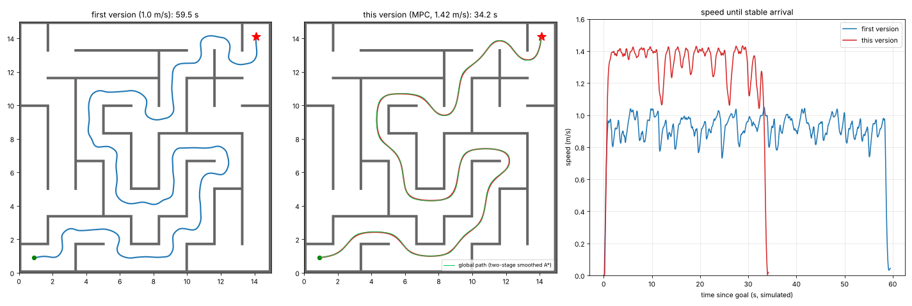

# 验证记录与范围

## 已完成

- C++17 核心（`tracking_core.hpp`、`astar_core.hpp`）以 `-Wall -Wextra -Wpedantic -Werror` 编译并通过断言测试（`bash scripts/check_core.sh`）：
  空路径、重复点、单点路径、NaN/Inf、指令上限、速度曲线（终点为零、弯道低于直道）、终点伺服的回拉、重规划迟滞、pursuit 备用模式、
  非法配置、稳态表求逆一致性；A* 的不可达、未知区域、对角穿墙、精确终点、平滑结果不进入致命区。
- YAML 参数非空、话题/坐标系/地图一致性、XML/Python 语法检查通过（`python3 scripts/check_static.py`）。
- 原版 `sp_nav_sim`、ControllerPlugin 接口和迷宫地图与基准提交对比无变化，SHA256 检查通过。
- 控制器/规划器 ROS 插件源码用最小 ROS 替身头文件做过编译检查（替身不在仓库中）。
- 原版动力学离线闭环（`tests/offline_plant.py`）：

| 配置 | 到 0.3 m | 稳定到达 | 静止误差 | 初始路径 平均 / RMSE / 最大 | 碰撞步数 |
|---|---:|---:|---:|---:|---:|
| MPC（默认） | 33.27 s | 34.20 s | 1.02 cm | 1.67 / 2.01 / 4.57 cm | 0 |
| pursuit | 32.83 s | 33.73 s | 0.73 cm | 2.07 / 2.55 / 6.02 cm | 0 |
| MPC + 25 ms 额外时延（`--latency 0.025`） | 33.53 s | 34.77 s | 0.20 cm | 1.13 / 1.46 / 6.77 cm | 0 |
| MPC + 40 ms 额外时延 | 33.80 s | 35.23 s | 0.19 cm | 0.69 / 1.27 / 6.39 cm | 0 |
| MPC，dead_time 0.16 s | 33.83 s | 35.67 s | 0.72 cm | 1.01 / 1.48 / 8.18 cm | 0 |
| MPC，dead_time 0.32 s | 34.13 s | 35.27 s | 0.36 cm | 3.03 / 3.66 / 7.94 cm | 0 |
| MPC，lag_gain 2.5 | 33.23 s | 34.13 s | 0.39 cm | 3.07 / 3.52 / 6.54 cm | 0 |
| pursuit + 25 ms 额外时延 | 33.13 s | 34.50 s | 0.53 cm | 1.45 / 1.90 / 7.92 cm | 0 |
| pursuit，dead_time 0.32 s | 32.13 s | 33.13 s | 0.96 cm | 4.46 / 5.38 / 11.40 cm | 0 |
| pursuit，lag_gain 2.5 | 32.60 s | 33.43 s | 0.39 cm | 2.53 / 3.06 / 6.54 cm | 0 |

每行是一次确定性试验，不是成功率估计。计算耗时（含 ctypes 开销）：控制 ≈ 53 µs 平均 / 110 µs P99，A* + 两阶段平滑 ≈ 12.8 ms 平均 / 69.6 ms 最长。原始数值见 `offline_results.json`，轨迹见 `traces/`。
上一轮默认（MPC 权重 300 / 0.2、单阶段平滑）为 34.03 s、终点 1.01 cm、平均/最大 1.81/5.51 cm；最初版本（几何跟踪 1.0 m/s）的同类结果为 59.57 s、终点 2.66 cm、RMSE 6.47 cm、最大 15.53 cm，保留在 `offline_results.json` 中供对比。

离线测试：控制 50 Hz、仿真 30 Hz、规划 10 Hz，原始起终点、两台同场机器人、原版速度滤波与旋转底盘碰撞逻辑；局部地图为测试侧复现。
它不能证明消息调度、QoS、插件动态加载、BT 或 GUI 正常，时间是模拟时间。

## 尚待验证（不能写成通过）

- Ubuntu 22.04 / ROS Humble `colcon build` 全工程编译（本版改动后尚未执行）。
- pluginlib 实际加载控制器（日志应有 `mode=mpc`）与 RViz 输入工具。
- `tests/ros_smoke.py` 完整双层 BT 导航；推到 GitHub 后 `.github/workflows/ubuntu22.yml` 会自动执行它。
- RViz 人工一次点击正式试验、视频、至少三轮独立结果。
- 虚拟机卡顿、TF/规划中断、取消等注入试验。

## 复现后填写

| 日期 | Ubuntu/ROS | 提交号 | 干净构建 | 单目标次数 | Action | 终端 elapsed | 最终距离 | RMSE/P95/最大值 | 碰撞观察 | 备注 |
|---|---|---|---|---|---|---|---|---|---|---|
| 待实测 | 22.04/Humble | 待填写 | 待测 | 待测 | 待测 | 待测 | 待测 | 待测 | 待测 | 保留日志/视频 |

